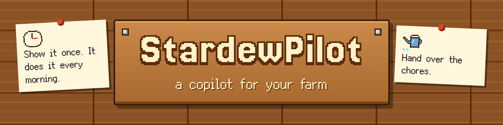
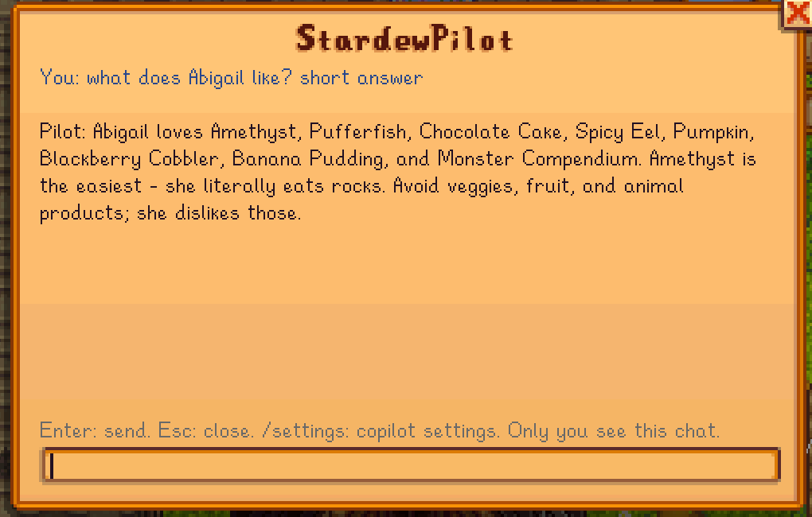
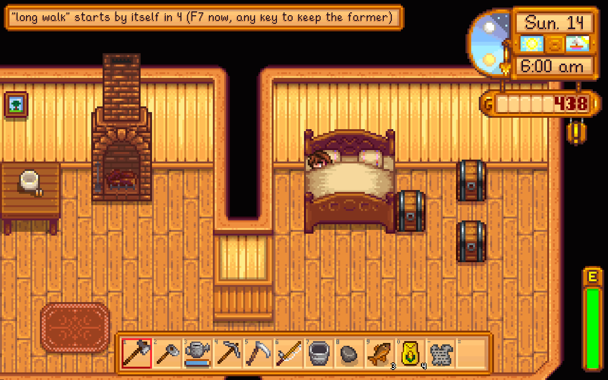
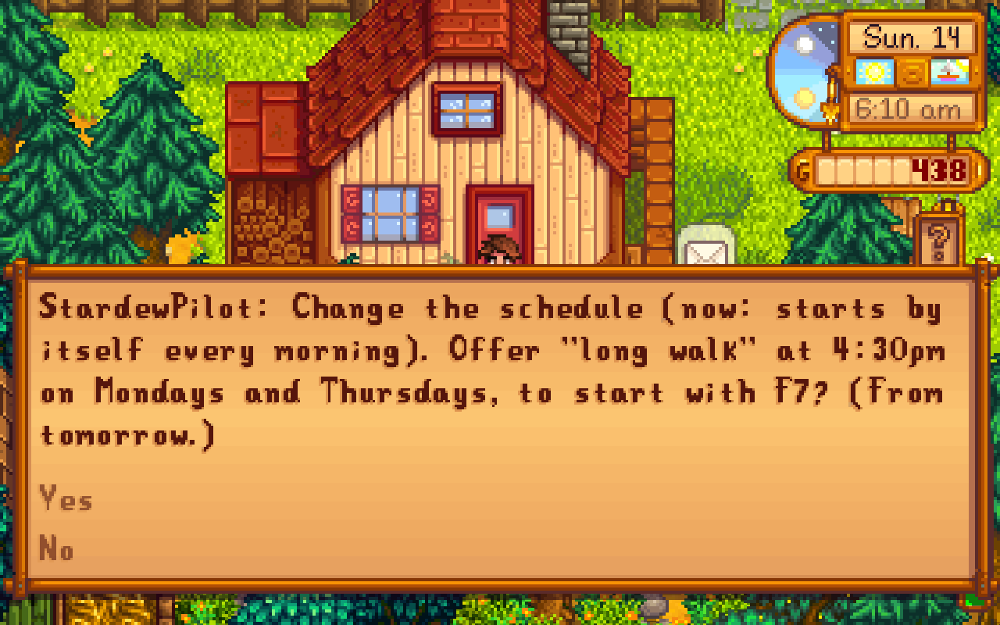
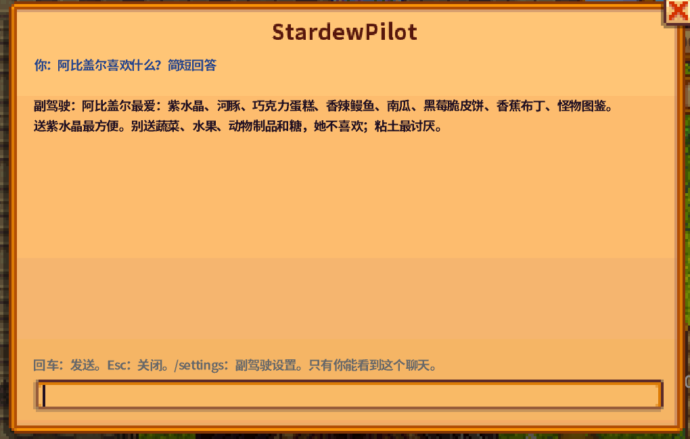
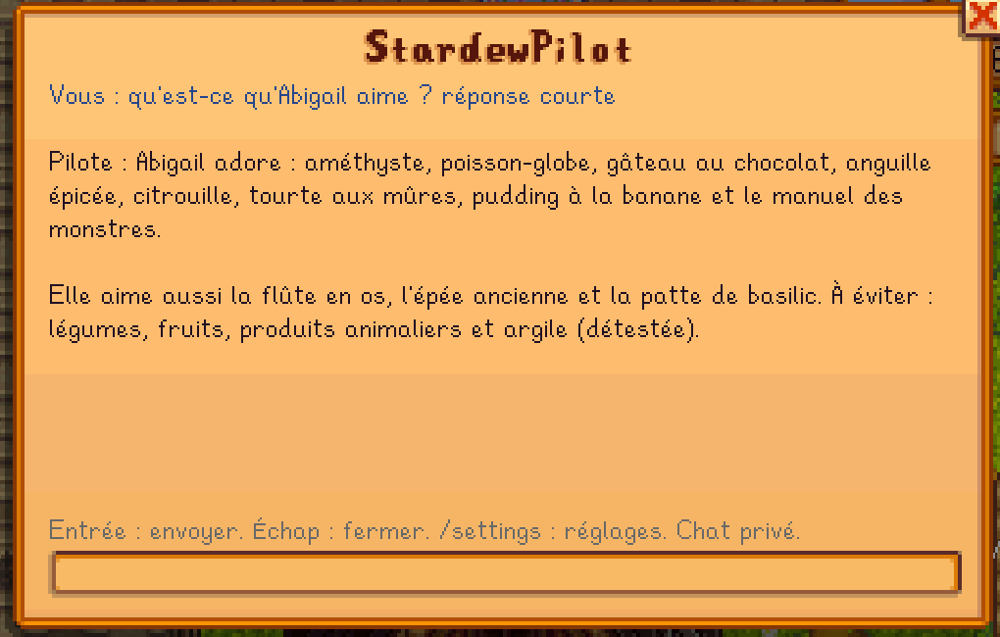

<div align="center">



**An AI copilot mod for Stardew Valley.**

Ask it anything, hand it the chores, or teach it your routine by doing it once. It plays the way a player does, and asks before anything that matters.

[](https://github.com/4444zyf/StardewPilot/releases/latest)


[](LICENSE)

[Website](https://getstardewpilot.pages.dev) · [Introduction](#introduction) · [Features](#features) · [Installation](#installation) · [Usage](#usage) · [Settings](#settings) · [Tools](#tools) · [Contributing](#contributing)

English · 简体中文 · Français · Русский in the game



</div>

##  Introduction

StardewPilot is a copilot that lives in your game. It has two parts: a SMAPI mod that shows the game to an AI agent and carries out its actions, and the agent itself, which runs beside the game on your computer with the model you choose. It can:

1. **Answer** questions from your running game: crops, gifts, fish, recipes, bundles, where your things are.
2. **Guide** you with tips and warnings, and a short briefing each morning.
3. **Do chores** you ask for: watering, harvest, planting, shopping, shipping, fishing, the mines, animals and machines.
4. **Play by itself** toward a goal you set, a whole day at a time.
5. **Learn your habits** by keeping a diary of what you do by hand.
6. **Learn a routine** you show it once, and run it on request or on a schedule.

A few ideas shape it:

- **The model plans; fixed code does the work.** The model decides what to do. Routines written in C# walk the farmer, spend energy and game time, and use the game's own menus, the way a player would.
- **Some rules the model cannot override.** Shipping, selling, gifts and large purchases ask you in the game. Moving stops it at once. At 11:30pm the farmer goes to bed. These are enforced in the mod, not asked of the model.
- **It answers from the game, not the wiki.** Knowledge tools read the running game's data and functions, so answers match your save and version.
- **Your keys stay out of the game.** The bridge listens only on 127.0.0.1 behind a token. Sign-ins and API keys live in the agent's own folder; the game never sees them.

> [!NOTE]
> Played and tested on Linux. **Windows: automated tests pass; not yet played by a person.** macOS should work but is untested. If you try it on Windows, please fill in the [Windows test report](https://github.com/4444zyf/StardewPilot/issues/new?template=windows-test.yml).

##  Features

| | |
| --- | --- |
| **Private chat** | <kbd>F8</kbd> opens a chat only you see; it never goes to the shared co-op chat. In single-player the clock stops while it is open and while the agent thinks. |
| **Tips and warnings** | Rule checks notice things worth saying (crops still dry in the evening, a birthday or festival, rain tomorrow, low energy far from home) and the agent words them. Warnings that must land before you act appear at once: a Community Center bundle item dropped in the shipping bin or sold to a shop, being out after midnight, energy almost gone. |
| **Morning briefing** | Weather, luck, birthdays, what is ready, last chances, yesterday's result, today's habit and routines. |
| **Autopilot** | Walks between maps and runs tasks: planting, watering, harvest, forage, shopping, shipping, chests, animals, machines, talking and gifts. <kbd>F9</kbd> switches it off and on. |
| **Fishing and the mines** | Finds open water, casts and plays the fishing minigame. Goes down mine floors, breaks rocks for ladders, and fights monsters next to the farmer. |
| **Self-play** | <kbd>F10</kbd> or "play by yourself, goal: earn 5,000g by summer". It plans each morning, plays the day, writes a summary and goes to bed, within a daily model budget. |
| **Apprentice mode** | A diary of what you do by hand, and the habits in it: your usual morning, bedtime, rainy days and weekdays, each with its evidence ("10 of 12 days"). |
| **Put my things away** | Empties the backpack into your own chests the way you already sort them. |
| **Teach by showing** | Say "watch me", do a task once, and name it. It plays back the steps it would run; you can change them before saving. |
| **Routines that start themselves** | "Do my truffle run every morning", "offer my town run at 4pm on Fridays". Offered when due and started with <kbd>F7</kbd>, or at 6am by itself if you touch nothing. |
| **Languages** | The mod's own text follows the game's language: English, 简体中文, Français and Русский. The copilot answers in the language you write in. |
| **Any model** | A subscription (ChatGPT Plus/Pro, GitHub Copilot and others), an API key, or a local model (Ollama, llama.cpp, any OpenAI-compatible service), set up on a settings page. |
| **Memory you can read** | Notes, goals, plans, day summaries and the diary are plain files in the mod folder. |

<p align="center">
 
 
</p>

##  How it works

```
┌──────────── Stardew Valley + SMAPI ────────────┐        ┌──────────────── agent (pi) ────────────────┐
│                                                │        │                                            │
│  StardewPilot mod (C#)                         │  JSON  │  StardewPilot extension (TypeScript)       │
│   game state ─► knowledge tools                │◄─RPC──►│   only the Stardew tools; pi's shell and   │
│   jobs ─► fixed routines that play the game    │  over  │   file tools are off                       │
│   rules ─► questions, stop, bedtime            │  Web-  │                                            │
│   chat window, tips, briefing, diary           │ Socket │  wrapper: settings page, sign-ins, restarts│
│   memory files (Mods/StardewPilot/data)        │ (local,│                                            │
│                                                │ token) │          ─► the model you choose           │
└────────────────────────────────────────────────┘        └────────────────────────────────────────────┘
```

- **Bridge mod** (`mod/`, C#, [SMAPI](https://smapi.io/)): exposes game state and actions over a local, token-protected WebSocket. It speaks JSON-RPC with MCP method names (`initialize`, `tools/list`, `tools/call`), so other agent frameworks can use it too.
- **Agent** (`agent/`, a [pi](https://github.com/earendil-works/pi) extension, TypeScript): runs alongside the game and uses the bridge as its only tools. It enables only the Stardew tools, blocks every other tool call, and replaces pi's coding system prompt.
- **Wrapper** (`agent/src/wrapper/`): started by the mod, it runs pi for you and serves the copilot settings page.
- Each game day starts a fresh agent session, seeded from the memory files.

The full plan is in [the design](docs/2026-11-15-agent-copilot-design.md).

##  Installation

### For players

You need Stardew Valley 1.6 on PC, [SMAPI](https://smapi.io/) 4.5+, [Node.js](https://nodejs.org/) 22.19+ and [pi](https://github.com/earendil-works/pi) 1.5+:

```sh
npm install -g --ignore-scripts @earendil-works/pi-coding-agent
```

1. Download the [latest release](https://github.com/4444zyf/StardewPilot/releases/latest) and unzip it into the game's `Mods` folder.
2. Start the game with SMAPI once. The SMAPI console shows `Bridge listening on 127.0.0.1:45781`, and the mod writes its `config.json`.
3. In `Mods/StardewPilot/config.json`, set `Launcher.Enabled` to `true` and start the game again. The copilot now starts with the game.
4. Set up the model (below), then press <kbd>F8</kbd> and ask "what should I do today?".

### Set up the model

No terminal needed: in the game, press <kbd>F8</kbd> and type `/settings`. The copilot settings page opens in your browser:

- **Sign in** with a subscription, add an API key, or add a custom or local endpoint (Ollama, llama.cpp, any OpenAI-compatible service).
- **Choose a model**, press **Test** (it checks that the model can call tools), then **Save and restart copilot**.

You can also set up before starting the game: `node <mod folder>/agent/src/wrapper/main.ts setup` opens the same page.

Claude works with an Anthropic API key only: Anthropic's terms do not allow a Claude Pro/Max subscription in other apps, so the copilot does not offer that sign-in.

Sign-ins are stored by pi in the copilot's own pi folder (`~/.config/StardewPilot/pi`, or `%APPDATA%\StardewPilot\pi` on Windows), separate from any other use of pi. Advanced settings on the page can switch to your normal `~/.pi/agent` instead. The page only listens on 127.0.0.1 and needs the private link the game opens.

### From source

You also need the .NET 6 SDK or newer.

```sh
dotnet build mod/StardewPilot -c Release   # builds the mod, copies it into the game's Mods folder, writes an installable zip
cd agent && npm install
```

On first run the mod writes a random token into its `config.json`, and writes the port and token to a connection file readable only by you (`~/.config/StardewPilot/bridge.json`, or `%APPDATA%\StardewPilot\bridge.json` on Windows). Then either turn on the launcher as above, or start pi yourself from the repo root and sign in with pi's own `/login`:

```sh
pi --no-builtin-tools -e ./agent/src/index.ts
```

`--no-builtin-tools` keeps pi's shell and file tools off. Type `/stardew` to check the game connection.

### Something wrong?

Type `pilot_diagnose` in the SMAPI console. It prints a self-check (versions, whether Node and pi were found, the copilot's state) without keys, tokens or links, ready to paste into an issue.

##  Usage

| Key | What it does |
| --- | --- |
| <kbd>F8</kbd> | Opens the private chat (`ChatKey`) |
| <kbd>F9</kbd> | Switches the autopilot off and on |
| <kbd>F10</kbd> | Starts or stops self-play |
| <kbd>F7</kbd> | Starts the routine on offer |

Ask things like "what should I do today?", "what does Abigail like?", "which crops need water?", "plant my parsnip seeds and water them" or "buy 5 cauliflower seeds".

### Rules the model cannot override

- At 11:30pm work stops and the farmer goes to bed.
- Tool use stops before energy runs out.
- Shipping, selling, gifting and purchases over 500g ask you first in an in-game question ("Yes", "Yes, and don't ask again", "No"). Using a chest in another farmer's house always asks.
- Moving or using a tool yourself stops the autopilot at once; so does a cutscene, festival or dialogue.
- After three failed actions in a row the agent must stop and explain.

### Tips and warnings

Rule checks in the mod notice things worth saying, and the agent words each tip in the game's language; it appears in the upper left. If no agent is connected, or it does not answer within 45 seconds, a fixed text is shown instead. Warnings that must land before you act are shown at once as fixed text, without waiting for the model.

### Self-play

Press <kbd>F10</kbd>, or ask "play by yourself, goal: earn 5,000g by summer". Without a goal the copilot follows a balanced first-year checklist. Each morning it writes a short plan for the day (shown in the chat; change it by telling the copilot), works through it, writes a summary at bedtime and goes to sleep. Moving, or pressing <kbd>F10</kbd> again, hands control back. A daily model budget (`SelfPlay.DailyRequestBudget`) caps the cost; when it runs out the copilot stops, and goes to bed if it is late.

### Apprentice mode

The copilot keeps a diary of what you do by hand, one line per stretch on one map (for example "6:00-8:40 the farm: Watering Can 44 swings, harvested Parsnip x15, petted 6 animals"), plus your bedtime. From the last two weeks it works out your habits: your usual morning in order, your usual bedtime, and what you do on rainy days or a given weekday. Each habit carries its evidence ("10 of 12 days").

- Say "do my usual morning" and the copilot runs the matching jobs in your order.
- Say "put my things away" and it empties your backpack into your own chests the way you already sort them: each item to the chest that holds most of it, else the one with most of its kind. Tools, the toolbar row and anything with no chest of its kind stay; mini-shipping bins and hoppers are never used.
- The morning briefing mentions the habit for the day ahead ("rain today; you usually fish at the mountain lake"), and offers your usual morning once, the first time it notices it.
- In self-play it plays your way; a goal you set still comes first.

Only what you do yourself counts, never what the copilot did. A habit is never permission: shipping, selling, gifting and spending still ask. The diary is plain files in the memory folder (`activity/<date>.json`, `habits.md`), kept for 56 game days. The model you chose sees the lines in its day notes and through two tools, as it sees other game state; nothing goes anywhere else. Type `/forget habits` in the chat to delete it all, or set `Apprentice.Enabled` to `false` to stop watching.

### Teach by showing

Say "watch me", do a task once by hand, and say "that's my truffle run". A line in the upper left shows while the copilot watches. It plays back what it saw and the steps it would run ("1. pick up every Truffle on the farm; 2. collect from every Oil Maker on the farm and refill them with Truffle; 3. store all Truffle Oil in the chest at (63,26)"). You can drop a step, change a count, or widen a step to all of its kind; then the game asks you to confirm, and "do my truffle run" runs it as one job.

- Steps are learned from what you do by hand for jobs that can be undone: watering, harvesting, forage, animals, machines, chests and talking. Buying, shipping and gifts only become steps when you ask the copilot to do them during the lesson, and in a routine they ask you every time, whatever your standing permissions say.
- Each step covers only the kinds you touched: the truffles, not the daffodils.
- A routine stops at the first step that fails or that you say no to, and is not started in the hour before work stops. Self-play never runs a routine that buys, ships or gifts.
- Chests are remembered by an id written into the chest, so a chest that was knocked aside is still found.
- A lesson works even with `Apprentice.Enabled` off, and is dropped at the end of the day.

Routines are saved at once in `routines.json` in the memory folder; you can edit the file, and it is checked again every time a routine runs.

### Routines that start themselves

"Do my truffle run every morning", "offer my town run at 4pm on Fridays", "my indoor chores when it rains". The game asks you to confirm the schedule, and it starts the next day.

- When a routine is due, a line in the upper left offers it, and <kbd>F7</kbd> (`Routines.StartKey`) starts it; the offer stays for two game hours.
- A 6am routine you set to start "by itself" starts after a five-second count, but only while you have touched nothing since waking, the farmer is at home or on the farm, and it is not a festival day. Any key, mouse movement or step cancels that for the day and leaves the offer.
- Nothing is offered while the copilot is thinking, during a lesson, in self-play, in the mines, or with the autopilot off. A routine runs at most once a day, whoever started it.
- Routines that buy, ship or gift can only be offered, and a routine that started by itself never opens a question: a step that would ask fails instead.
- At the work stop time a scheduled routine just stops; the farmer is not walked to bed.
- Starts and results show as a short message (a failure at the same step as last time goes only to the chat), and the copilot is told what ran. The morning briefing names today's routines.

"Stop doing my truffle run every morning" removes a schedule; `Routines.StartThemselves: false` turns all of them off.

### Languages

The mod's own text (the chat window, tips and warnings without the copilot, questions, routine messages, the morning briefing's fixed text) follows the game's language: English, Chinese (简体中文), Russian and French, from `i18n/` in the mod folder. Other game languages show English. The copilot replies in the language you write in. Text only the copilot reads (tool results, the diary, `habits.md`) stays English.

### Memory

Memory lives in `Mods/StardewPilot/data/<farm>/player-<id>/` as plain files you can read and edit: `notes.md`, `goal.txt`, `plan.md` and `days/<date>.md`. It follows the game's save: what the copilot writes during a day is kept only if the day is saved (you sleep), just like the game. Each game day starts a fresh agent session seeded from these files.

##  Settings

In the mod's `config.json`:

| Setting | Default | Meaning |
|---|---|---|
| `ChatKey` | `F8` | Opens the chat |
| `Chattiness` | `Important` | `Off`, `Important` or `Talkative` |
| `MaxTipsPerDay` | `6` | Proactive tips per game day (warnings do not count) |
| `Warnings` | `true` | Instant fixed-text warnings |
| `TellMeEverything` | `false` | Allow spoilers about content the save has not reached |
| `MorningBriefing` | `true` | A short briefing at the start of each game day (off when `Chattiness` is `Off`) |
| `PauseWhileThinking` | `true` | Single-player: stop the clock while the agent thinks (not while it acts) |
| `Autopilot.ToggleKey` | `F9` | Switches the autopilot off and on |
| `Autopilot.StopWorkAt` | `2330` | Game time when work stops and the farmer goes to bed |
| `Autopilot.MinEnergy` | `10` | Tool use stops before energy drops below this |
| `Autopilot.ConfirmSpendAbove` | `500` | Purchases above this ask first |
| `Autopilot.AlwaysAllow` | all `false` | Standing permissions: `Ship`, `Sell`, `Spend`, `Gift`, `Trash` |
| `Autopilot.FullSelfPlay` | `false` | No confirmations at all (other players' things in co-op still ask) |
| `SelfPlay.ToggleKey` | `F10` | Starts or stops self-play |
| `SelfPlay.DailyRequestBudget` | `120` | Model requests per game day (0 for no limit) |
| `SelfPlay.DailyTokenBudget` | `0` | Model tokens per game day (0 for no limit) |
| `SelfPlay.FollowMyHabits` | `true` | Self-play follows the habits the copilot learned by watching you |
| `Apprentice.Enabled` | `true` | Keep a diary of what you do and learn your habits (files stay in the mod's data folder) |
| `Routines.StartThemselves` | `true` | Offer scheduled routines when due, and let a 6am routine set to "by itself" start when you touch nothing after waking (schedules stay saved when off) |
| `Routines.StartKey` | `F7` | Key or controller button that starts the routine on offer |
| `Launcher.Enabled` | `false` | Start the agent together with the game (one-click) |
| `Launcher.UseWrapper` | `true` | Start pi through the wrapper, which serves the settings page. `false` starts pi directly |
| `Launcher.NodeCommand` | `node` | The Node.js executable that runs the wrapper |
| `Launcher.PiCommand` | `pi` | The pi executable |
| `Launcher.Model` | empty | Optional first model, for example `openai/gpt-5`. After that the settings page decides |

##  Tools

The agent's only tools come from the bridge. The knowledge tools answer from the running game: its data files, and its own functions where it has one (machine output, sell prices, craftable counts, the Collections page). Each result says which parts were computed by the mod instead (for example "possible now" for fish and gold per day for crops). The mod does not read the wiki.

<details>
<summary><b>Knowledge tools</b> (26)</summary>

| Tool | What it returns |
|---|---|
| `get_status` | Date, time, weather, money, energy, location, held item, menu or event state |
| `get_inventory` | Backpack slots with items, quality and prices |
| `get_location` | A map's exits, buildings, NPCs, forage, machines and chests |
| `get_crops` | Crops by type: ready, need water, dead, days to harvest |
| `get_calendar` | Festivals and birthdays this season, tomorrow's weather |
| `get_relationships` | Hearts, talked today, gifts this week for every villager met |
| `get_gift_tastes` | A villager's loved, liked, disliked and hated gifts |
| `get_item_info` | Item prices and categories; seed seasons and growth times |
| `get_skills` | Skill levels, experience, professions |
| `get_quests` | Quest log and special orders |
| `get_bundles` | Community Center bundles, once the farmer can read them |
| `get_shop_stock` | What a shop sells today, with prices |
| `get_fish_info` | Where, when and in what weather a fish bites; which fish a map has and which can bite now |
| `get_crop_plan` | Crops for a season: seed prices, growth, sell price, harvests left, gold per day |
| `get_recipes` | Cooking and crafting recipes: ingredients, known or not, how learned, how many can be made now |
| `get_machine_info` | What a machine accepts and what it makes from an item, and how long it takes |
| `get_collections` | Collections progress and what can still go to the museum |
| `get_npc_schedule` | Where a villager is now and the rest of today's plan |
| `find_items` | Where the player's things are: backpack, chests on every map, fridges, the Junimo chest, ready machine output |
| `get_gift_ideas` | Gifts the player owns that a villager loves or likes, and gifts left today and this week |
| `get_bundle_plan` | What the bundles still need, what the player has, where to get the rest and until when |
| `get_day_briefing` | Today's overview: weather, luck, birthdays, what is ready, last chances, yesterday's result |
| `get_animals` | Farm animals, pets and their buildings: petted, produce ready, feeding spots, hay |
| `get_activity_log` | What the player did on recent days, as the mod watched it (today so far included) |
| `get_habits` | The player's habits with their evidence: usual morning, bedtime, rainy days and weekdays |
| `list_routines` | The player's saved routines, with their steps in words, whether each can run, and each schedule with today's state |

</details>

<details>
<summary><b>Actions</b> (each returns done, partly done or failed, with a reason)</summary>

| Tool | What it does |
|---|---|
| `walk_to` | Walks to a map, a tile or a villager, across maps through doors and map edges |
| `water_crops` | Waters every dry crop, refilling the can at the nearest water |
| `harvest_crops` | Harvests ready crops (hand or scythe) |
| `plant_seeds` | Uses empty soil, or clears and tills new soil near the house, plants, then waters |
| `collect_forage` | Picks up forage on a map |
| `buy_items` | Walks to the shop and buys through the shop menu; respects opening hours |
| `ship_items` | Puts items in the shipping bin (asks first; keeps one of any bundle item) |
| `store_in_chest`, `take_from_chest` | Moves items between the backpack and a chest; takes from fridges and the Junimo chest too, optionally by quality |
| `put_things_away` | Puts the backpack away into your own chests, following how you already sort them |
| `tend_animals` | Picks up eggs and grabber contents, puts out hay, pets the animals and the pet, milks or shears (not after 7pm) |
| `tend_machines` | Collects ready machine output on a map, and can refill one kind of machine with an item |
| `talk_to`, `give_gift` | Talks to or gifts a villager (gifting asks first) |
| `fish` | Finds open water, casts, strikes and plays the fishing minigame |
| `explore_mines` | Goes down mine floors: takes ladders, breaks rocks to find them, fights monsters next to the farmer; stops at low health or energy |
| `go_to_bed` | Walks home and sleeps |
| `clear_way` | Walks to a tile, cutting wild trees and stumps and clearing weeds, stones and twigs on the way (never fruit or tapped trees) |
| `use_tool`, `interact` | Low-level fallbacks on one tile; `use_tool` reports what was on the tile before and after the swing |
| `stop_autopilot` | Stops the current action |
| `start_lesson`, `end_lesson` | "Watch me": records what the player does, then proposes a routine from it |
| `save_routine`, `forget_routine` | Saves the proposed routine (with the player's changes, after an in-game yes), or deletes one |
| `run_routine` | Runs a saved routine, its steps one after another as one job |
| `schedule_routine`, `unschedule_routine` | Gives a routine a schedule (offered when due, or by itself at 6am; after an in-game yes), or removes it |

</details>

Memory and self-play: `read_memory`, `write_notes`, `write_day_plan`, `write_day_summary`, `set_self_play`.

##  Documentation

The design documents explain why each part works the way it does:

- [Agent copilot](docs/2026-11-15-agent-copilot-design.md): the overall plan and build order
- [Settings and sign-in](docs/2026-11-15-agent-settings-and-login-design.md) · [Knowledge tools and Windows](docs/2026-11-15-knowledge-and-windows-design.md)
- [Daily helpers and chores](docs/2026-11-16-daily-helpers-and-chores-design.md) · [Apprentice mode](docs/2026-11-16-apprentice-mode-design.md) · [Habits in the briefing](docs/2026-11-16-habits-in-the-briefing-design.md) · [Put it away my way](docs/2026-11-16-put-it-away-my-way-design.md)
- [Teach by showing](docs/2026-11-17-teach-by-showing-design.md) · [Routines that start themselves](docs/2026-11-17-routines-that-start-themselves-design.md)

## Project layout

| Path | What |
| --- | --- |
| `mod/StardewPilot/` | The SMAPI mod: bridge, tools, autopilot jobs, guide, apprentice, memory, `i18n/` |
| `mod/Platform.Tests/` | Tests for the mod's system-specific code, without the game |
| `agent/` | The pi extension, the wrapper (settings page and pi supervisor), and their tests |
| `website/` | The project website, [getstardewpilot.pages.dev](https://getstardewpilot.pages.dev), in four languages ([its README](website/README.md)) |
| `docs/` | Design documents |
| `scripts/` | Dev scripts |

## Development

- CI (GitHub Actions, Linux and Windows) runs the agent and wrapper tests, the wrapper against the real pi, and the mod's system-specific code (`mod/Platform.Tests`). The game itself cannot run in CI.
- `dotnet run --project mod/Platform.Tests`: tests the mod's system-specific code (config folder, private files, status file, starting the agent, the bridge listener, `pilot_diagnose`, translations) without the game.
- `cd agent && npm install && npm test`: tests the extension offline against recorded bridge messages (`agent/test/fixtures`), and the wrapper's settings server and pi supervisor with fakes.
- `node agent/test/ci/wrapper-smoke.ts`: starts the wrapper with the installed pi in a throwaway folder, signs in with a made-up key, and checks that pi starts and stops with it.
- `node agent/src/wrapper/main.ts status`: shows the wrapper's state and model.
- `scripts/restart-game.sh`: rebuilds the mod and restarts the game (Linux; starts SMAPI directly, so Steam need not run).
- `node website/build.ts`: builds the website into `website/dist`.
- A release build (`dotnet build mod/StardewPilot -c Release`) also writes an installable zip next to the DLL.
- Dev options in the mod's `config.json`: `Dev.AutoLoadSave` (a save folder name to load at the title screen) and `Dev.FreezeTime`.

## Status and roadmap

Steps 1 to 4 of the build order work: the read-only bridge, the in-game guide (private chat overlay, proactive tips, instant warnings), the commanded autopilot, and self-play toward a goal you set. From step 5: fishing (including the minigame), a basic mines-and-combat routine, and a one-click launcher.

- **v0.4.0** (latest, on GitHub, not on Nexus): daily helpers (morning briefing, item finder, gift ideas, bundle plan), animal and machine chores, apprentice mode and "put my things away".
- **v0.3.1** removed the Claude Pro/Max sign-in, which Anthropic's terms do not allow in other apps.
- **v0.3.0** added knowledge tools that answer from the running game, Windows fixes tested in CI, and `pilot_diagnose`.
- **Next release:** teach by showing, routines that start themselves, and the four languages are built and tested and will be in the next release.

## Contributing

- **Bugs:** open an [issue](https://github.com/4444zyf/StardewPilot/issues) with the output of `pilot_diagnose` from the SMAPI console.
- **Windows players:** the [Windows test report](https://github.com/4444zyf/StardewPilot/issues/new?template=windows-test.yml) is the most useful thing you can send right now.
- **Translations:** the mod's text is in `mod/StardewPilot/i18n/`, the website's in `website/locales/`. Corrections from native speakers are welcome; a test checks that every language has the same keys.

## Acknowledgements

Built on [SMAPI](https://smapi.io/) and [pi](https://github.com/earendil-works/pi). The website and README use the [Fusion Pixel](https://github.com/TakWolf/fusion-pixel-font) and [Jersey](https://fonts.google.com/specimen/Jersey+15) fonts (SIL Open Font License); the pixel art is drawn for this project.

StardewPilot is an unofficial fan-made mod. It is not affiliated with or endorsed by ConcernedApe. Stardew Valley is a trademark of ConcernedApe LLC.

## Licence

MIT. See [LICENSE](LICENSE).
